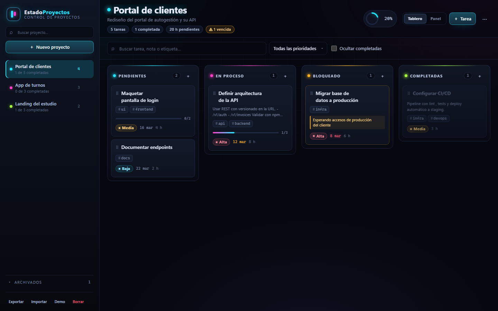
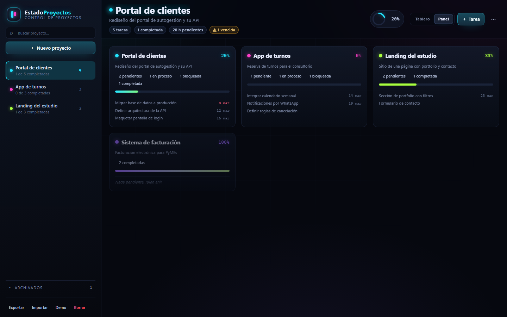
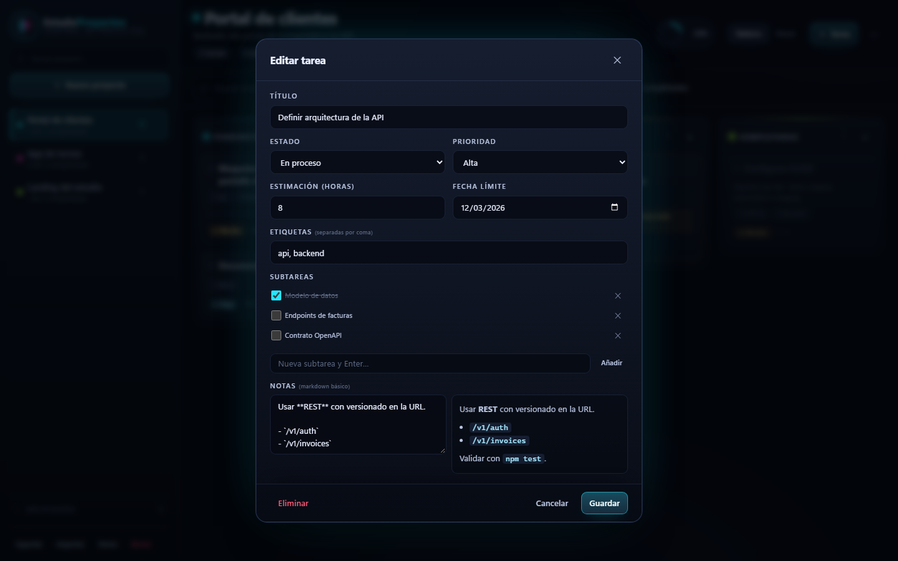
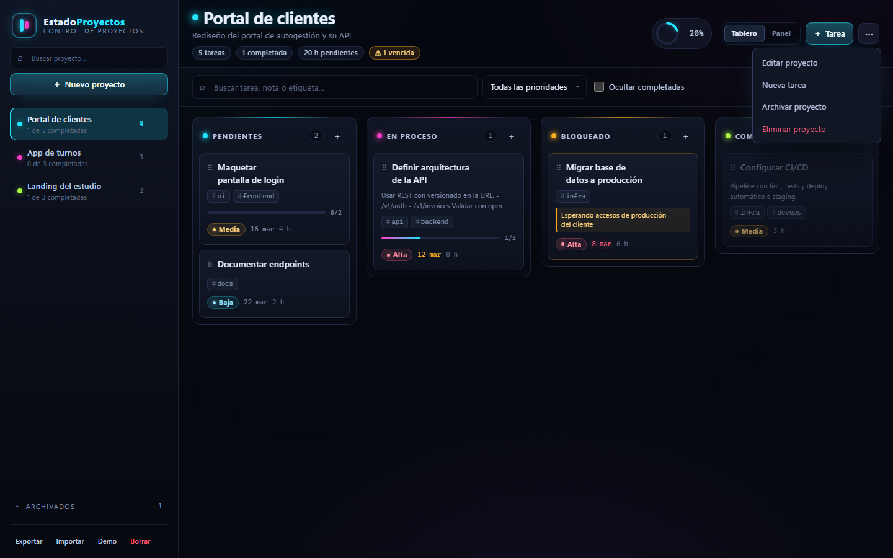
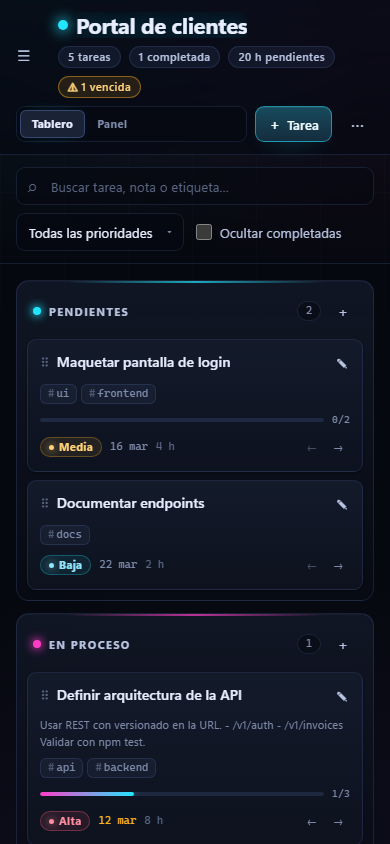

# EstadoProyectos

Tablero kanban **dark/neon** para llevar el control de mis proyectos de software: qué está
pendiente, qué está en proceso, qué está bloqueado y qué está terminado.

Hecho con **HTML, CSS y JavaScript puro** (scripts clásicos, sin build ni dependencias en runtime).
Los datos viven en tu navegador (`localStorage`) y se pueden exportar/importar como JSON.



## Cómo abrirlo

Doble clic en `index.html`. No hace falta servidor, instalación ni conexión a internet.

Si preferís servirlo con Node:

```bash
npm start            # http://127.0.0.1:4173
```

## Funcionalidades

- **Un tablero por proyecto** con cuatro columnas: Pendientes, En proceso, Bloqueado y Completadas.
- **Drag & drop** con ratón (HTML5) y **pulsación larga en táctil**, con previsualización de la
  posición de destino y auto-scroll.
- **Alternativa por teclado** y botones `←` / `→` en cada tarjeta.
- **Tareas ricas**: prioridad, etiquetas, estimación en horas, fecha límite (vencidas en rojo),
  notas con markdown básico y **subtareas** con barra de progreso.
- **Auto-completado opcional**: si todas las subtareas están hechas, la tarea pasa a Completadas.
- **Panel de proyectos** con progreso, reparto por estado y próximas tareas.
- **Buscador y filtros** por texto, prioridad y "ocultar completadas".
- **Proyectos archivables** (no se pierden) y eliminación con confirmación.
- **Deshacer** tareas eliminadas desde el aviso.
- **Backup**: exportar/importar JSON, restaurar datos demo o borrar todo.
- **Accesible**: foco visible, diálogos con foco atrapado, anuncios `aria-live`, `aria-pressed`
  y `aria-current`, respeto por `prefers-reduced-motion`.
- **Responsive**: sidebar fija en escritorio, drawer en tablet/móvil, columnas apiladas en móvil.
- **Cada proyecto tiene su acento neón** y toda la interfaz se tiñe con él.

## Capturas

| Panel de proyectos | Editar tarea |
| --- | --- |
|  |  |

| Menú de proyecto | Móvil |
| --- | --- |
|  |  |

## Atajos de teclado

| Atajo | Acción |
| --- | --- |
| `Alt` + `←` / `→` | Mover la tarea a la columna anterior/siguiente |
| `Alt` + `↑` / `↓` | Reordenar la tarea dentro de su columna |
| `Enter` / `Espacio` | Abrir el detalle de la tarjeta enfocada |
| `n` | Nueva tarea |
| `/` | Enfocar la búsqueda de tareas |
| `Supr` | Eliminar la tarea enfocada (con confirmación) |
| `Esc` | Cerrar diálogo, menú o drawer |
| `Tab` | Navegar (el foco queda atrapado dentro de los diálogos) |

## Datos y backups

Todo se guarda en `localStorage` bajo la clave `estadoproyectos.v1`. No se envía nada a ningún
servidor ni se hacen peticiones de red.

- **Exportar**: descarga `estadoproyectos-AAAA-MM-DD.json`.
- **Importar**: valida y normaliza el archivo antes de reemplazar los datos (con confirmación).
- Los datos incompletos o dañados se normalizan al cargar; si son ilegibles, se regeneran los demo.

Estructura del backup:

```jsonc
{
  "version": 1,
  "activeProjectId": "p_...",
  "projects": [{
    "id": "p_...",
    "name": "Portal de clientes",
    "description": "...",
    "accent": "#22e6ff",
    "archived": false,
    "autoComplete": true,
    "tasks": [{
      "id": "t_...",
      "title": "...",
      "notes": "**markdown** básico",
      "status": "todo",            // todo | doing | blocked | done
      "priority": "alta",          // baja | media | alta
      "tags": ["api"],
      "estimate": 8,               // horas
      "dueDate": "2026-03-12",     // o null
      "subtasks": [{ "id": "s_...", "title": "...", "done": false }],
      "order": 0,
      "blockedReason": ""
    }]
  }]
}
```

## Estructura

```
index.html          # markup, plantillas y orden de scripts
css/theme.css       # tokens: paleta dark, acentos neón, sombras y motion
css/base.css        # reset, fondo, tipografía y utilidades
css/layout.css      # shell, sidebar, topbar, tablero y responsive
css/components.css  # tarjetas, columnas, diálogos, menús, avisos
js/utils.js         # helpers (DOM, fechas, etiquetas, debounce)
js/storage.js       # localStorage, export/import
js/seed.js          # datos de ejemplo del primer arranque
js/state.js         # modelo, CRUD, orden de columnas y métricas
js/markdown.js      # parser mínimo que escapa el HTML primero
js/render.js        # sidebar, cabecera, tablero y panel
js/dragdrop.js      # ratón, táctil y teclado
js/modals.js        # diálogos, menús flotantes y avisos
js/app.js           # arranque y acciones globales
tools/serve.js      # servidor estático sin dependencias (dev/tests)
tests/              # suite E2E de Playwright
```

## Tests

La suite cubre estado y persistencia, render, drag & drop (ratón, táctil y teclado), CRUD de
proyectos y tareas, markdown seguro (anti-XSS), accesibilidad, responsive y capturas visuales.

```bash
npm install
npx playwright install chromium
npm test                 # 74 tests, Chromium
npm run test:headed      # con navegador visible
npm run test:ui          # modo interactivo
npm run test:update      # regenerar capturas de docs/screenshots
```

## Limitaciones conocidas

- Los datos son **locales al navegador**: no hay sincronización entre dispositivos (usá
  exportar/importar para mover un backup).
- En modo incógnito o con almacenamiento bloqueado, la app avisa y funciona solo en memoria.
- El markdown es intencionalmente básico (negrita, cursiva, código, listas, citas y enlaces).

## Licencia

MIT — ver [LICENSE](LICENSE).
